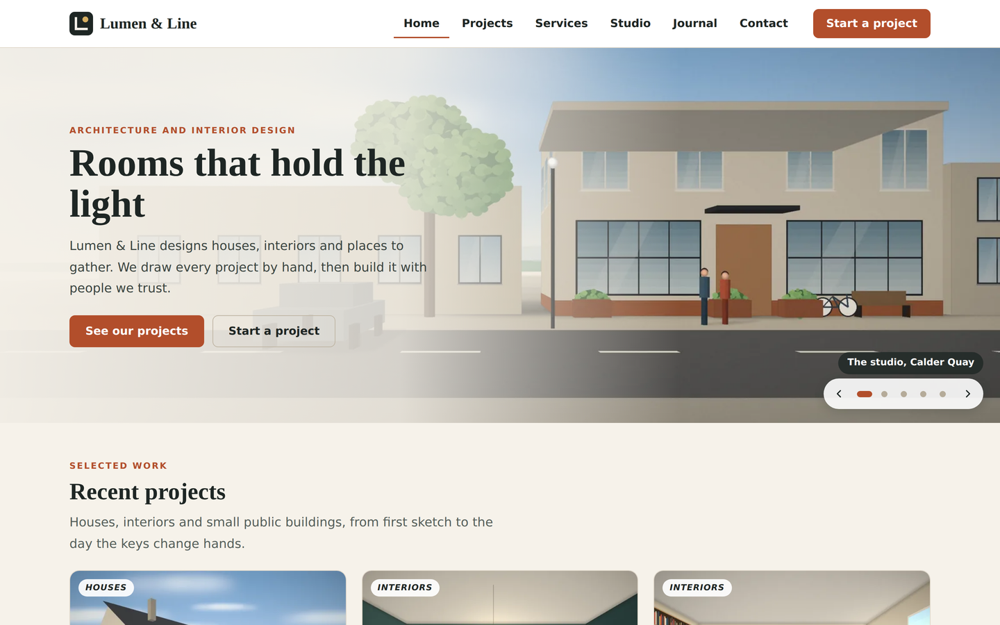
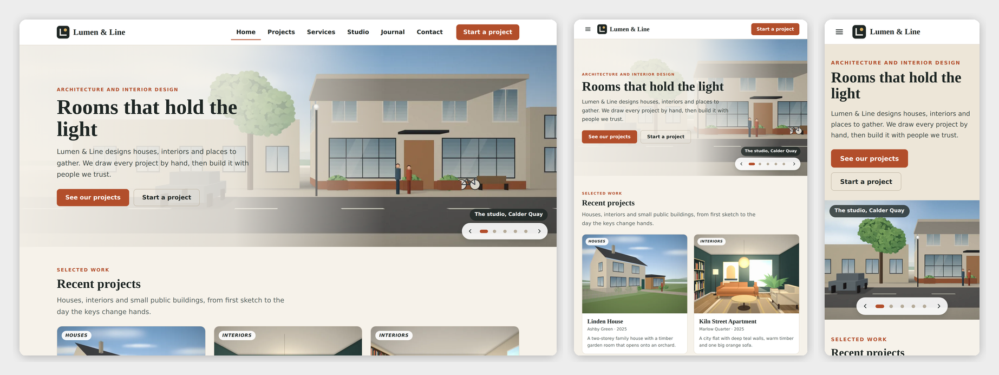

# Lumen & Line — SkyNet Architecture Studio Template

A responsive website template for an architecture and interior design studio, for **ASP.NET Core (.NET 10)**, built on the **SkyNet Framework**.

[](https://dotnet.microsoft.com/)
[](https://www.nuget.org/packages/TheSkyLite.SkyNet)



> **Sample content.** Lumen & Line, its projects, people and pictures are invented placeholders; replace them in the staff area (Pages, Projects, Services, Team, Journal and press, Settings). The inquiry form already saves for real, into `data/messages.json`, and shows in the staff Messages inbox.

## Features

- **7 public pages:** Home (a 7-second slideshow of the studio and its rooms), Projects (portfolio with type, year and search filters), Project (photo gallery, before and after slider, facts for location, year, size and scope), Services, Studio (practice and team), Journal and press (one page, filtered by topic, with article view) and Contact (project inquiry form).
- **Staff area with one admin account:** Dashboard, Pages editor, Media library, Projects, Services, Team, Journal and press, Messages, Settings, Activity log and My account. There are no roles and no extra accounts.
- **Pages editor:** click any text to change it, drag blocks to reorder, hide or remove them, add blocks, edit the Home slideshow in a Slides list, keep the last five versions and restore one.
- **Media library:** every picture or video on the site (page blocks, slides, project covers, galleries, before and after pairs, team portraits, journal covers) is chosen from the library through one shared picker. Uploads are checked by content, not by file name; a file still in use cannot be deleted.
- **Inquiry form:** server-side validation, a honeypot field and a limit of 5 inquiries per 10 minutes per connection.
- **Activity log:** every change and every refused request.
- **Responsive:** desktop, tablet and phone layouts; admin tables become cards on phones.
- **No front-end build:** plain HTML, CSS and vanilla JavaScript.



## Getting started

Requirements: .NET 10 SDK.

    git clone <repo url>
    cd DesignStudio
    dotnet run

The SkyNet package (`TheSkyLite.SkyNet`) restores from NuGet. The app opens on **Home** at http://localhost:5230.

## Run mode

`appConfig/application.cfg` has `app.app.runmode`:

- **0 Demo** (as shipped): the staff sign-in at **/AdminLogin** is filled in (`demo` / `demo1234`) and any user name and password signs in as the demo manager.
- **1 Production:** the admin signs in with a real password. Set this before you go live.

## Sample data

The site ships with 9 projects (3 with before and after pairs), 5 services, 4 team members, 7 journal and press entries, 5 sample inquiries and 43 pictures. There are no sample staff accounts: Demo mode signs in without one. The sample files are `data/site.json`, `data/media.json` and `data/messages.json`.

## Going live

1. Set `app.app.runmode | 1` in `appConfig/application.cfg`.
2. Start the site and open **/AdminLogin**. On this first start in Production the site removes the sample inquiries, the activity log and any staff account, keeps your pages, projects, services, team, journal and media, writes `data/initialized.txt`, and shows a new first password. This happens once; later starts never remove anything.
3. Follow **First sign-in** below.

To wipe the sample inquiries while still in Demo, open **Settings**, **Initialize data**, and type `INITIALIZE`.

## First sign-in (Production)

1. Run the site on your computer and open **/AdminLogin**. The page shows the user name (`admin`) and a password made just for this site. It is shown only on the computer the site runs on, and is also in `appConfig/initial-admin.txt`.
2. Sign in and choose your own password. The box and the file disappear.
3. Change your name or password later in **My account**.

Forgot the first password before using it? Delete `appConfig/initial-admin.txt` and open the sign-in page again. Locked out? Delete `data/staff.json` and open the sign-in page again.

## Deploying

1. Publish with the `web.config` from the project (IIS). Give the application pool Modify on `data/`, `temp/`, `appConfig/` and `images/uploads/`. Use HTTPS.
2. If nobody has signed in yet, read the first password from `appConfig/initial-admin.txt` on the server.
3. Check that `/data/staff.json` and `/appConfig/initial-admin.txt` answer 404 in a browser.

> **Redeploying:** publishing copies `data/` and `images/uploads/` over the live files. Download the live folders first or leave them out of the publish.

## Project structure

    appConfig/    application.cfg (run mode, release date)
    codes/        one C# class per page, plus Core/ (storage, sign-in, media, blocks) and Models/
    htmls/        page markup with {plhd_*} placeholders
    scripts/      one JavaScript namespace per page
    styles/       one stylesheet per page, every class prefixed
    data/         site.json, media.json, messages.json (the activity log and staff file are made at run time)
    images/       43 sample pictures with thumbnails, the logo, and uploads/ for new files

19 pages (7 public, the sign-in page and 11 staff pages), 21 C# files, about 18,000 lines of source and 87 image files.

### One page = four files, one name

| File | Holds |
|---|---|
| `codes/[Page].cs` | the page class and its server methods |
| `htmls/[Page].html` | markup with `{plhd_*}` placeholders |
| `scripts/[Page].js` | one IIFE namespace, `[Page]Js` |
| `styles/[Page].css` | styles, every class prefixed (`hm-` Home, `pj-` Projects, `pd-` Project, `pr-` staff Projects, and so on) |

## SkyNet in action

```javascript
$ApiRequest('Projects/Filter', JSON.stringify([{ key: 'kind', vlu: 'interior' }, { key: 'yr', vlu: '0' }, { key: 'term', vlu: '' }]));
```

```csharp
public async Task<ApiResponse> Filter()
{
    ApiResponse response = new ApiResponse();
    SiteData site = await Store.LoadSite();
    response.SetElementContents("pj-results", ResultsHtml(Match(site, kind, yr, term)));
    response.ExecuteScript("ProjectsJs.filtered('" + kind + "'," + yr + ",'" + Ui.Js(term) + "');");
    return response;
}
```

| Page | Request | Response |
|---|---|---|
| Projects | `Filter` | the project cards, count and URL |
| Journal | `Filter` | the entries for one topic |
| Contact | `Send` | field errors, or the thank-you note and a saved inquiry |
| AdminPages | `Save` | saves the blocks, shows the page again |
| AdminMedia | `Upload` | adds files to the library and refreshes the grid |

## Customize it

- **Content:** edit it in the staff area, or edit `data/site.json`.
- **Brand name, tagline, phone, email, address:** Settings in the staff area.
- **Colors and fonts:** the variables at the top of each `styles/*.css` file.

## License

See the [LICENSE](LICENSE) file at the project root: the template and sample code are MIT licensed, and the SkyNet Framework (`TheSkyLite.SkyNet`) is proprietary and free to use for eligible users, including commercially.
